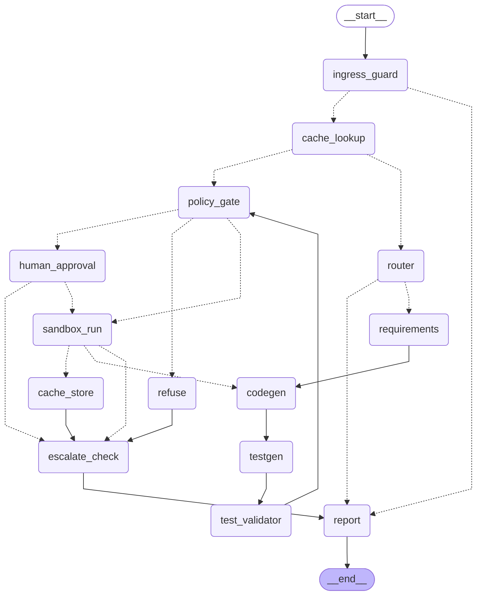

# CodeForge: Multi-Agent Verified Code Generation Platform

> **Guiding Principle**: *"Model proposes, plain Python decides."*

CodeForge is a production-grade multi-agent platform that translates natural language into secure, executable, and empirically verified Python code. Every line of generated code is statically audited via AST analysis, executed in a locked-down subprocess sandbox, and honestly reported through deterministic execution status.

---

## Architecture Flowchart



---

## Team Split & Ownership

| Area | Lead | Core Responsibilities |
| :--- | :--- | :--- |
| **1. Pipeline & Orchestration** | Pipeline Owner | LangGraph state graph machine, Multi-agent reasoning chain (`Router`, `Requirements`, `CodeGen`, `TestGen`, `TestValidator`), AST syntax validation, repair loop on test failure. |
| **2. Safety & Security (R1, R2)** | Safety Owner | Strict identity isolation from configuration, PII scrubber (Credit Cards with Luhn, Aadhaar with Verhoeff, Phone numbers, API keys), pure AST policy gate, and isolated tempdir sandbox with `rlimits` and blocked network. |
| **3. Reliability & Cost (R4, R5)** | Reliability & Cost Owner | Exponential retry loops with full jitter, circuit breakers, 60% chaos injection testing, offline template degraded tier, semantic cache with token guard verification, and message compaction. |
| **4. Quality, HITL & Evals (R6)** | Quality & Evals Owner | 35-case golden evaluation test suite with hard/soft thresholds, CI integration, human-in-the-loop approval interrupts, P1/P2/P3 support escalation, Gradio 5-tab UI, and 42-case adversarial red team suite. |

---

## 3 Core Architectural Decisions

### 1. Fail-Closed Degraded Tier
- **Problem**: When upstream LLM providers suffer rate limiting (429) or outages (503), naive fallback to lower-capability models can generate risky or broken code, or crash the application.
- **Decision**: When primary and fallback models fail, CodeForge never guesses and never auto-approves risky actions. It falls back to pre-verified deterministic offline templates (e.g. palindrome, factorial, fibonacci, fizzbuzz, primes). If a request does not match an offline template, it fails closed with an honest refusal and opens a human support ticket.

### 2. Policy Gate as Pure AST Function, Not LLM
- **Problem**: Relying on an LLM "evaluator" prompt to decide if code is safe is vulnerable to prompt injection, evasion, and jailbreaks.
- **Decision**: Security policies are evaluated exclusively by pure, deterministic Python `ast.parse()`. The code is statically scanned for forbidden modules (`os`, `sys`, `subprocess`, `shutil`), dangerous built-ins (`eval`, `exec`, `__import__`), dunder attribute introspection, and unauthorized file/network access. If unparseable or disallowed, execution is halted with zero lines ever sent to runtime.

### 3. Honest Report Strictly Derived from Exit Codes
- **Problem**: Generative models frequently hallucinate that broken implementations or failed tests "passed successfully".
- **Decision**: The final user report is generated by a deterministic Jinja2 template (`templates/report.md.j2`) that reads raw Python state. The phrase `"✅ Tests passed"` is programmatically unreachable unless the sandboxed `pytest` process exited with return code `0`. Any failure reports exact failed test names and truncated stderr.

---

## Project Structure

```text
codeforge/
├── agents/             # Agent definitions (Router, Requirements, CodeGen, TestGen, TestValidator, Evaluator)
├── hitl/               # Human-in-the-loop approvals & support ticket escalation
├── guard/              # Ingress PII scrubbers (Luhn, Verhoeff, API key patterns)
├── policy/             # Pure AST code policy evaluation (DENY, NEEDS_APPROVAL, ALLOW)
├── sandbox/            # Isolated subprocess test runner with rlimits & blocked network
├── store/              # SQLite persistence, role-isolated RunStore, quotas, idempotency
├── resilience/         # Jitter retries, circuit breakers, chaos injection, offline templates
├── cost/               # Semantic cache with token guards, metering, and compaction
├── prompts/            # Clean agent system prompts
├── app_gradio.py       # 5-tab Gradio interactive dashboard
├── cli.py              # Command-line interface
├── graph.py            # LangGraph state machine builder
└── config.py           # Identity, profile, and quota configuration
evals/
├── golden_set.json     # 35 golden evaluation cases (hard & soft tiers)
├── reference_tests/    # Hidden reference test suites for golden evaluation
└── test_golden.py      # Golden test gate assertion engine
redteam/
└── corpus.yaml         # 42 adversarial test cases (injection, jailbreaks, malicious code)
scripts/
├── demo.py             # Replays the 4 core incidents in terminal
├── chaos_run.py        # 20-request chaos benchmark suite
├── cost_benchmark.py   # Baseline vs optimized semantic cache benchmark
└── feedback_to_golden.py # Flywheel script appending user feedback to golden evals
```

---

## Quickstart & Installation

### 1. Prerequisites
- Python 3.11+
- `uv` package manager (`curl -LsSf https://astral.sh/uv/install.sh | sh`)

### 2. Setup Environment
```bash
git clone https://github.com/sourabhkumargupta/codeforge.git
cd codeforge

# Install all dependencies into virtual environment
uv sync
```

### 3. Configure Credentials (Optional)
```bash
cp .env.example .env
# Edit .env with your GROQ_API_KEY if testing against live LLMs.
# CodeForge operates fully self-contained offline via its resilient template tier.
```

---

## Running CodeForge

### Command Line Interface (CLI)
```bash
# Basic request
uv run python -m codeforge.cli "Write a function to check if a string is a palindrome"

# Run as specific user profile (e.g. instructor or student)
CODEFORGE_PROFILE=instructor_a uv run python -m codeforge.cli "Write an is_prime checker"
```

### Gradio Interactive Web UI (5 Tabs)
```bash
uv run python -m codeforge.app_gradio
```
Access the application at `http://localhost:7860`:
- **Chat**: Code generation, honest status, solution/tests viewer, 👍/👎 feedback flywheel.
- **My Runs**: Role-isolated run history (cross-user access strictly blocked).
- **Reviewer Queue**: Instructor-only approval dashboard for sensitive operations.
- **Tickets**: Sanitized human support escalation tickets.
- **Ops**: Real-time token cost table, circuit breaker status, chaos toggle.

---

## Testing & CI Evaluation Gates

### Run All Unit Tests
```bash
uv run pytest tests/unit -v
```

### Run Golden Evaluation Gate
```bash
# Run full evaluation suite (hard pass requirement: 100%, soft pass: ≥85%)
make gate
```

### Live Gate Demo (Red → Green)
Demonstrate how the evaluation gate protects against safety regressions:
```bash
# Weakens policy by removing 'os' from deny list -> Trips gate red with failing case name
make gate-red

# Restores policy and confirms all hard and soft gates pass 100%
make gate-green
```

### Run Adversarial Red Team Suite
```bash
uv run pytest tests/redteam/test_corpus.py -v
```

---

## Live Demo Narrative
To present or replay the four core incidents:
```bash
uv run python scripts/demo.py
```
See [`demo/demo_script.md`](file:///Users/sourabhkumargupta/Projects/gen%20AI%20live/codeforge/demo/demo_script.md) for the complete presenter narration.
