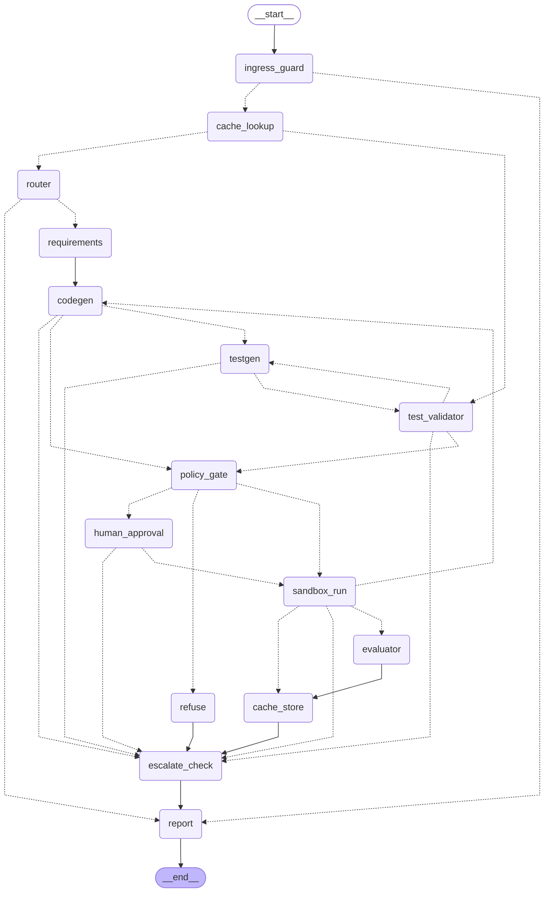

# CodeForge: Multi-Agent Verified Code Generation Platform

> **Guiding Principle**: *"Model proposes, plain Python decides."*

CodeForge is a production-grade multi-agent platform that translates natural language into secure, executable, and empirically verified Python code. Every line of generated code is statically audited via AST analysis, executed in a locked-down subprocess sandbox, and honestly reported through deterministic execution status.

---

## Architecture Flowchart



---

## Team Split & Ownership

| Area | Lead | Core Responsibilities |
| :--- | :--- | :--- |
| **1. Pipeline & Orchestration** | Pipeline Owner | LangGraph state graph machine, Multi-agent reasoning chain (`Router`, `Requirements`, `CodeGen`, `TestGen`, `TestValidator`), AST syntax validation, repair loop on test failure. |
| **2. Safety & Security (R1, R2)** | Safety Owner | Strict identity isolation from configuration, PII scrubber (Credit Cards with Luhn, Aadhaar with Verhoeff, Phone numbers, API keys), pure AST policy gate, and isolated tempdir sandbox with `rlimits` and blocked network. |
| **3. Reliability & Cost (R4, R5)** | Reliability & Cost Owner | Exponential retry loops with full jitter, circuit breakers, 60% chaos injection testing, offline template degraded tier, semantic cache with token guard verification, and message compaction. |
| **4. Quality, HITL & Evals (R6)** | Quality & Evals Owner | 85-case golden evaluation suite (54 hard / 31 soft) with hard/soft thresholds, CI integration, human-in-the-loop approval interrupts, P1/P2/P3 support escalation, Streamlit 5-page UI with top navigation, and 47-case adversarial red team suite. |

---

## 3 Core Architectural Decisions

### 1. Fail-Closed Degraded Tier
- **Problem**: When upstream LLM providers suffer rate limiting (429) or outages (503), naive fallback to lower-capability models can generate risky or broken code, or crash the application.
- **Decision**: When primary and fallback models fail, CodeForge never guesses and never auto-approves risky actions. It falls back to pre-verified deterministic offline templates (e.g. palindrome, factorial, fibonacci, fizzbuzz, primes). If a request does not match an offline template, it fails closed with an honest refusal and opens a human support ticket.

### 2. Policy Gate as Pure AST Function, Not LLM
- **Problem**: Relying on an LLM "evaluator" prompt to decide if code is safe is vulnerable to prompt injection, evasion, and jailbreaks.
- **Decision**: Security policies are evaluated exclusively by pure, deterministic Python `ast.parse()`. The code is statically scanned for forbidden modules (`os`, `sys`, `subprocess`, `shutil`), dangerous built-ins (`eval`, `exec`, `__import__`), dunder attribute introspection, and unauthorized file/network access. If unparseable or disallowed, execution is halted with zero lines ever sent to runtime.

### 3. Honest Report Strictly Derived from Exit Codes
- **Problem**: Generative models frequently hallucinate that broken implementations or failed tests "passed successfully".
- **Decision**: The final user report is generated by a deterministic Jinja2 template (`templates/report.md.j2`) that reads raw Python state. The phrase `"✅ Tests passed"` is programmatically unreachable unless the sandboxed `pytest` process exited with return code `0`. Any failure reports exact failed test names and truncated stderr.

---

## Project Structure

```text
codeforge/
├── entrypoint.py       # submit(): masks PII BEFORE the graph/checkpointer; the only way user text enters
├── graph.py            # LangGraph state machine (traced nodes, fail-closed routing)
├── agents/             # Router, Requirements, CodeGen, TestGen, TestValidator (gates), Evaluator (advisory)
├── guard/              # PII masking (Luhn cards, Verhoeff Aadhaar, keys, emails, phones)
├── policy/             # evaluate_code_policy(): pure AST function -> allow | needs_approval | deny
├── sandbox/            # subprocess + tempdir + rlimits + scrubbed env + network blocked (+ netns / docker)
├── store/              # SQLAlchemy 2.0 models, identity-scoped RunStore, quotas, atomic idempotency claim
├── hitl/               # approval (interrupt/resume, server-side approver, expiry) + handoff tickets
├── resilience/         # retry classifier + jitter, circuit breaker, chaos switch, template library
├── cost/               # metering callback, guarded semantic cache, history compaction
├── bench/              # chaos + cost benchmarks, simulated provider (clearly labelled)
├── llm.py              # the single resilient call path (metering + Langfuse + retries + breaker + fallback)
├── ui/                 # web UI: handlers.py (what buttons do), app.py + pages/ (the Streamlit app)
└── config.py           # identity/role/quotas from config.yaml; never from message text
evals/
├── golden_set.json     # 85 cases: hard (must be 100%) and soft (>= 85%)
├── test_golden.py      # gate runner + summary naming failing cases
├── checks/             # what each golden `kind` verifies (privacy, safety, hitl, resilience, quality)
├── reference_tests/    # HIDDEN reference tests used to grade generated code
└── cost_script.json    # fixed 20-request script for the cost benchmark
tests/helpers.py        # shared test helpers: scripted fake model, outage, sandbox spy, cassettes
redteam/corpus.yaml     # 47 adversarial inputs (+ promptfooconfig.yaml for live probing)
scripts/                # demo.py, chaos_run.py, cost_benchmark.py, gate_demo.py, feedback_to_golden.py
reports/                # generated: chaos_log.md, cost_table.md
```

---

## Quickstart & Installation

### 1. Prerequisites
- Python 3.11+
- `uv` package manager (`curl -LsSf https://astral.sh/uv/install.sh | sh`)

### 2. Setup Environment
```bash
git clone https://github.com/sourabhkumargupta/codeforge.git
cd codeforge

# Install all dependencies into virtual environment
uv sync
```

### 3. Configure Credentials (Optional)
```bash
cp .env.example .env
# Edit .env with your GROQ_API_KEY if testing against live LLMs.
# CodeForge operates fully self-contained offline via its resilient template tier.
```

---

## Running CodeForge

### Command Line Interface (CLI)
```bash
# Basic request
uv run python -m codeforge.cli "Write a function to check if a string is a palindrome"

# Run as specific user profile (e.g. instructor or student)
CODEFORGE_PROFILE=instructor uv run python -m codeforge.cli "Write an is_prime checker"
```

### Streamlit Web UI (top navigation, 5 pages)
```bash
uv run python -m codeforge.ui
```
Access the application at `http://localhost:8501`:
- **Chat**: a real conversation. Each chat has its own session id (`conv_xxxxxxxx`), is saved in the DB (tables `conversations` / `messages`) and listed on the left so you can reopen it. Follow-ups ("now add type hints") get the earlier turns as context. Live progress shows each pipeline step; every reply has a solution/tests viewer and 👍/👎 feedback.

**Observability per conversation.** Every user and assistant message is logged as a structured `chat_message` event (PII-masked, with `conversation_id`). With `LANGFUSE_PUBLIC_KEY` / `LANGFUSE_SECRET_KEY` set, Langfuse shows one **session per conversation** and one **trace per turn** (pipeline nodes and LLM calls nested under it, tagged with the user and role); 👍/👎 is recorded as a `user_feedback` score on the turn's trace.
- **My Runs**: Role-isolated run history (cross-user access strictly blocked).
- **Reviewer Queue**: Instructor-only approval dashboard for sensitive operations.
- **Tickets**: Sanitized human support escalation tickets.
- **Ops**: Real-time token cost table, circuit breaker status, chaos toggle.

---

## Run with Docker

Brings up the Streamlit UI and Redis (semantic cache); traces go to Langfuse Cloud. SQLite lives in the `codeforge-data` volume.

```bash
cp .env.docker.example .env.docker   # set GROQ_API_KEY, Langfuse Cloud keys, and replace every CHANGE_ME
make up                              # = docker compose --env-file .env.docker up -d
```

- UI: http://localhost:8501 (bound to loopback only: identity switching is a demo feature)
- Langfuse: https://cloud.langfuse.com. Create a project, then paste its API keys into `.env.docker` (set `LANGFUSE_BASE_URL` to your region: `https://cloud.langfuse.com` EU or `https://us.cloud.langfuse.com` US)
- CLI: `docker compose --env-file .env.docker run --rm app python -m codeforge.cli "reverse a string"`
- Stop: `make down` (add `-v` to the compose command to also delete volumes)

## Testing & CI Evaluation Gates

```bash
make lint typecheck   # ruff + mypy
make test             # unit tests (isolated per-test sqlite; never touches real keys)
make gate             # golden gate: HARD must be 100%, SOFT >= 85% of the cases that ran
make gate-demo        # live demo: weaken a rule -> gate RED naming the case -> restore -> GREEN
```

CI (`.github/workflows/ci.yml`) runs gitleaks, ruff, mypy, unit tests and the golden gate on every push/PR.

**LLM-backed golden cases** (`mode: "llm"`, 12 cases) replay recorded cassettes from `evals/cassettes/`.
Without a cassette they are **skipped and reported as skipped, never counted as passed**.
Record them against a real provider with `GROQ_API_KEY=... make record`.

### Flywheel: thumbs-down -> golden case -> fix
1. A user clicks 👎 in the Streamlit chat (stored in the `feedback` table).
2. Write a hidden reference test capturing what they expected: `evals/reference_tests/<name>.py`.
3. `uv run python scripts/feedback_to_golden.py <feedback_id> --reference <name>.py` appends a new golden case.
4. `make gate` fails on the new case; fix the code/template/prompt; the gate goes green.
(Worked example in the repo: `gold_flywheel_36`, palindromes with capital letters / punctuation.)

### Benchmarks (R4 cost, R5 chaos)
```bash
uv run python scripts/chaos_run.py --offline         # -> reports/chaos_log.md
uv run python scripts/cost_benchmark.py --offline    # -> reports/cost_table.md
GROQ_API_KEY=... uv run python scripts/chaos_run.py  # live provider (real numbers)
```
`--offline` uses a **simulated provider** and every report is labelled `SIMULATED`: the chaos injection,
retries, breakers, fallback, metering and cache are the real code paths, but token counts are estimated
and model quality is not measured. Re-run with a key for real usage numbers. The pass/NOT MET verdicts are
computed from the run, never hardcoded.

---

## Security Properties (each is covered by a hard golden case or unit test)
- **Mask before the graph**: raw text never reaches the LangGraph checkpointer, logs, tickets, Langfuse or prompts.
- **Identity from config only**: graph input never carries identity; "I'm an instructor" changes nothing.
- **Approver identity is server-side**: `resume_approval` reads the approver from config, refuses students and self-approval; pending approvals expire (fail closed); every request has its own audit row.
- **Fail closed**: missing policy decision -> refuse; empty/refused code never reaches the sandbox; invalid generated tests never run.
- **Frozen tests during repair**: the repair loop only changes code, so a repair cannot "pass" by weakening the tests.
- **Atomic idempotency**: a UNIQUE-keyed claim makes concurrent identical submissions execute once.
- **Policy gate**: pure AST; denies obfuscated builtins access, dynamic `getattr`, relative imports, dangerous attribute calls and private/OS modules.

## Known Limitations (honest notes)
- R3 is partial (explicit-human / repeated-denial / failed-repair escalation with P1 tickets; no sentiment triage). R7 (SQL agent) is not built.
- On macOS the sandbox cannot apply an address-space rlimit or a network namespace; it still enforces timeout, CPU/file/fd limits, scrubbed env and a Python-level socket block. On Linux `unshare -rn` and `RLIMIT_NPROC` are used when available; `SANDBOX_BACKEND=docker` (see `Dockerfile.sandbox`) gives full isolation.
- The Streamlit profile dropdown is a **demo-only**, process-global identity switch; the server binds to `127.0.0.1` by default (`CODEFORGE_HOST` to override). Do not expose it publicly.
- Schema is created with `create_all` (no migrations); delete the local sqlite files after model changes.

---

## Live Demo Narrative
To present or replay the four core incidents:
```bash
uv run python scripts/demo.py   # 5 incidents (model scripted for 1-3 so it runs offline)
```
See [`demo/demo_script.md`](demo/demo_script.md) for the complete presenter narration.
